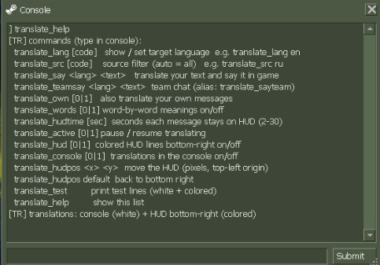
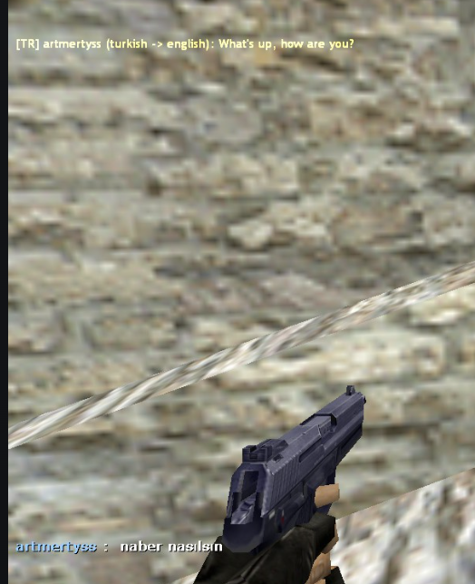

# cs_translate

Real-time chat translator for **Counter-Strike 1.6**. A client-side `.asi`
plugin — when someone writes in Russian, Bulgarian, Arabic, German … you get
the translation in your console and on a colored HUD overlay.

```
[TR] Путин (russian -> english): hi, how are you
```

Client-side only: nothing is sent to the server, the game is not modified,
no ASI loader needed — the game loads `.asi` files by itself. Powered by
Google Translate, source language detected automatically.

## Install

1. Download `cs_translate.asi` from [Releases](../../releases).
2. Drop it into your CS 1.6 folder (the one with `hl.exe`):

   `...\Steam\steamapps\common\Half-Life\cs_translate.asi`

3. Start the game, open the console (`` ` ``) — you should see
   `[TR] translator ready - target: en | source: auto`.

That's it. Settings live in `%APPDATA%\cs_translate\cs_translate.ini`.

## Usage

Just play — every chat line is translated as it arrives. Detection first tries
the languages you meet most (`priority_langs` in the ini: turkish, russian,
bulgarian, romanian, english). A built-in glossary covers what Google misreads:
game jargon (`mix`, `recap`, `boost`, `hns` …) stays as typed, romanized russian
(`suka`, `blyat`, `nahui` …) and turkish chat slang (`amk`, `oc`, `keske` …) are
translated into your target language. Random spam (`xaxxaxaa`, `5555555`,
`KOAFSDOAKSDAJOSFDOJ`) is skipped without asking Google.

| Command | What it does |
|---|---|
| `translate_lang tr` | target language — default is `en` (`tr`, `ru`, `de`, `fr` …) |
| `translate_say <lang> <text>` | translate your text (jargon kept) and say it in game |
| `translate_teamsay <lang> <text>` | same, but only your team sees it |
| `translate_own 1` | also translate your own messages |
| `translate_words 1` | word-by-word glossary line on/off |
| `translate_hudtime 10` | seconds each message stays on the HUD |
| `translate_hudpos 40 400` | move the HUD (`default` = bottom left) |
| `translate_hud 0` / `translate_console 0` | HUD / console output off |
| `translate_test` / `translate_help` | test lines / command list |

Everything you change is saved and survives a restart.

## Build

```bat
cmake -S . -B build -A Win32
cmake --build build --config Release
```

Requirements: Visual Studio, CMake 3.16+, Windows, internet.

## Screenshots

| Commands | HUD |
|---|---|
|  |  |

## License

MIT — see [LICENSE](LICENSE).
